## 👋 Salut, moi c'est Auguste

Passionné d'informatique et de nouvelles technologies, j'apprends en construisant : des sites, des outils, des expériences autour de l'IA locale et de la fabrication numérique. J'aime comprendre comment les choses fonctionnent, puis les transformer en projets concrets.

Curieux de sciences (maths, physique), j'avance par essais successifs : je crée, je teste, je recommence.

---

## 🧭 Ce que je construis

| Domaine | Ce que j'y fais |
|---|---|
| **Web & automatisation** | Sites statiques HTML/CSS/JavaScript, scripts PowerShell, GitHub Actions, API GraphQL |
| **IA locale** | LLM en local avec Ollama et Open WebUI, modèles Qwen, OpenRouter, OpenHands, optimisation GPU |
| **Infrastructure** | Docker, PostgreSQL, Supabase, déploiement sur Cloudflare Pages (Wrangler) et Netlify |
| **Fabrication numérique** | Impression 3D (Creality K1, OrcaSlicer, Klipper), conception de pièces, électronique et prototypage |

## 🛠️ Stack

**Développement**

**Outils & infrastructure**

**IA & fabrication**

---

## 📌 Projets mis en avant

<!-- PINNED-REPOS-START -->
| Dépôt | Description | Langage | Étoiles |
|---|---|---|---|
| [GitHub-Desk](https://github.com/BEGY02300/GitHub-Desk) | Application de bureau en français pour gérer les dépôts, branches, pull requests et issues GitHub sur Windows, macOS et Linux. | Python | ⭐ 1 |
<!-- PINNED-REPOS-END -->

[Voir tous mes dépôts →](https://github.com/BEGY02300?tab=repositories)

---

## 📊 Activité

  

Carte générée chaque jour par GitHub Actions (dépôts publics).

<picture>
  <source media="(prefers-color-scheme: dark)" srcset="https://raw.githubusercontent.com/BEGY02300/begy02300/output/github-snake-dark.svg" />
  <source media="(prefers-color-scheme: light)" srcset="https://raw.githubusercontent.com/BEGY02300/begy02300/output/github-snake.svg" />
  
</picture>

---

## 🎯 Centres d'intérêt

<table>
<tr>
<td width="33%" valign="top">
<b>💻 Développement & informatique</b> 
Web, scripts, automatisation, serveurs et infrastructure.
</td>
<td width="33%" valign="top">
<b>🤖 IA & LLM locaux</b> 
Ollama, Qwen, performances et usage du GPU.
</td>
<td width="33%" valign="top">
<b>🖨️ Maker</b> 
Impression 3D, électronique, prototypage.
</td>
</tr>
<tr>
<td valign="top">
<b>🎮 Jeux & simulation</b> 
Simulation, construction, gestion, jeux PC et PlayStation.
</td>
<td valign="top">
<b>🏎️ Sport automobile</b> 
F1, WRC, MotoGP : performances, histoire et technologie.
</td>
<td valign="top">
<b>✈️ Aviation</b> 
Histoire aéronautique, météo, pilotage et Microsoft Flight Simulator 2024.
</td>
</tr>
</table>

## 🚀 Objectif

Construire un portfolio technique solide : des projets plus complets, une pratique sérieuse du développement, et une exploration continue de l'IA locale et des technologies récentes.

---

**BEGY02300** · *Je crée, je teste, je recommence.*

France · Développement · Technologie · Innovation

