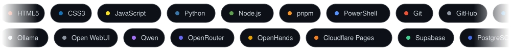

  

 

Je m'appelle Auguste, je vis en France et j'apprends le développement en construisant des choses : des sites statiques, des scripts, des outils, et de l'IA qui tourne sur ma propre machine. Le reste du temps, j'imprime en 3D, je regarde la F1 ou je vole sur Flight Simulator.

- **Web** : sites statiques, Cloudflare Pages et Functions, GitHub Actions
- **IA locale** : Ollama, Open WebUI, modèles Qwen, OpenRouter, OpenHands
- **Fabrication** : Creality K1, OrcaSlicer, Klipper, un peu d'électronique

  

## Projets

<!-- PINNED-REPOS-START -->

<!-- PINNED-REPOS-END -->

## Activité

  

 

<picture>
  <source media="(prefers-color-scheme: dark)" srcset="https://raw.githubusercontent.com/BEGY02300/begy02300/output/github-snake-dark.svg" />
  <source media="(prefers-color-scheme: light)" srcset="https://raw.githubusercontent.com/BEGY02300/begy02300/output/github-snake.svg" />
  
</picture>

Les cartes ci-dessus sont générées chaque jour par GitHub Actions à partir de mes dépôts publics.

## Hors écran

Sport automobile (F1, WRC, MotoGP), simulation de vol (Microsoft Flight Simulator 2024), jeux de simulation et de gestion, et tout ce qui touche à l'aviation.
